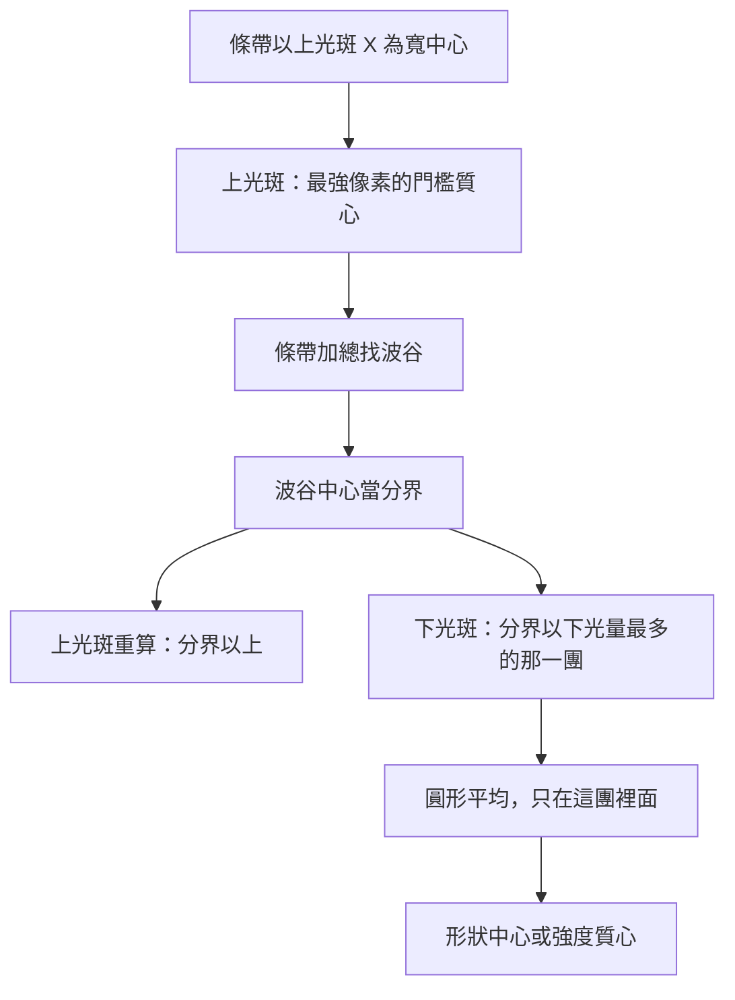

# 上下光斑演算法

對齊程式：`dual_spot.py` 的 `locate_dual_spots`、`spot_window.py` 的條帶位置（2026-10-13）

分析視窗在合成影像上抓兩個光斑。找點一律用線性強度。畫布左上角的「log」只改熱圖、平滑圖和條帶的顯示，數值是 log10，不參與找點。log 和 color scale 中間的 abs 也只改顯示。abs 右邊的平滑用 Gaussian blur，只改熱圖和圓形平均預覽。同時勾選時，熱圖和圓形平均預覽先取絕對值，再做 Gaussian blur，再套 color scale，最後才是 log。條帶圖只取絕對值，不套 color scale，也不套這個平滑。找點不參與這三個勾選。條帶只調寬度，左右以上光斑的 X 為中心，不能手動移動。Y 固定為整張影像高度。左側的平滑窗仍是下光斑圓形平均的直徑，跟畫布上的 Gaussian blur 分開。

---

## 總流程

座標都是全影像像素，原點在左上，Y 向下。

---

## 1. 上光斑

1. 扣掉條帶四邊的中位數，負值截成 0。
2. 門檻 = 使用者百分比 × 這張圖的最強訊號。預設 50%。
3. 留下不低於門檻、而且跟最強像素連在一起的那一塊。
4. 上光斑是這一塊的強度加權質心。

半透明白色遮罩就是這一塊。

找到波谷之後會再算一次，分界以下的列清掉，所以上光斑不會跨過波谷中心。

---

## 2. 條帶與波谷

條帶寬度由使用者設定。左右位置以上光斑的 X 為中心，不能另調。貼到影像邊緣時會被裁切，這時中心會盡量靠近上光斑。Y 仍是整張高度。

條帶是這段寬度裡每一列沿 X 的加總，再減掉這條曲線的中位數，負值截成 0。它只用來找波谷，不是下光斑的 Y。

從上光斑往下找局部波峰，至少隔 6 列。一個波峰要同時滿足：

- 它和上光斑之間的最低點，不高於這個波峰的 65%。
- 波峰再往下，曲線要掉到不高於波峰的 75%。

通過的波峰裡取最高的那個，用來確認中間這個谷是上下光斑的分界。

波谷中心不是最低的那一個點。谷底是「比谷底高出兩峰較小上升量的 15%」以內的那一段，分界取這一段的中點。

---

## 3. 下光斑

範圍從波谷中心的下一列，一直到條帶底部。

1. 先扣四邊背景，再扣這個範圍左右邊緣的中位數。邊緣當背景，避免把光暈下緣一起扣掉。
2. 留下大於 0 的像素，取總光量最大的連通區。這就是下光斑的圓。小亮點光量比較少，不會蓋過整團。
3. 平滑窗是這個圓的直徑，做圓形平均。偶數會自動加 1。平均只做在已經圈好的範圍裡，不會把範圍往外抹。
4. 中心有兩種，在分析視窗的「演算法」選擇：

- 形狀中心：範圍內每個像素一樣重，落在光團的幾何中間。
- 強度質心：用圓形平均後的強度加權。

\[
x = \frac{\sum x_i I_i}{\sum I_i}, \quad
y = \frac{\sum y_i I_i}{\sum I_i}
\]

\(I_i\) 是平均後的線性強度。亮的像素權重高，所以會比形狀中心更靠近上面較亮的一側。兩種都不是抓強度最大的那一個像素。

這個質心必須在波谷中心下方，且與上光斑的 Y 距離大於 2 像素，否則視為沒找到。

平滑窗變大只會改變範圍內的權重，讓這團更圓，不會把質心一路往下拉。左側平滑圖是整張合成影像的圓形平均，用來對照，不參與圈選。滾輪可縮放，雙擊復原。色階跟合成影像的色條一起變；log 開啟時，平滑圖也用同一組 log10 色階。

滑鼠移到左側條帶曲線上時，會標出該點的 Y 像素和畫面上的加總值。熱圖和條帶的游標讀數都顯示在畫布左下方，高度固定為兩列。

---

## 參數

| 參數 | 作用 |
| --- | --- |
| 寬 | 條帶寬度。左右以上光斑 X 為中心，不能手動調位置 |
| 門檻 % | 上光斑留下不低於峰值這個比例的核心 |
| 平滑窗 | 下光斑圓形平均的直徑。範圍先圈好，窗只改範圍內的權重 |
| 演算法 | 形狀中心或強度質心 |
| log | 畫布左上角。只改顯示，數值是 log10 |
| abs | log 和 color scale 中間。熱圖、圓形平均預覽和條帶圖改顯示絕對值。和 color scale 同時勾時，熱圖和圓形平均預覽先取絕對值，有勾平滑再做 Gaussian blur，然後套門檻。不參與找點 |
| 平滑 | abs 右邊。勾選後熱圖和圓形平均預覽做 Gaussian blur，可調水平核寬、垂直核寬和 sigma，預設 3、3、0.8。某一邊為 1 時該方向不平滑。有勾 color scale 時先平滑再套門檻，最後才是 log。跟左側平滑窗不同。不參與找點，條帶圖也不套 |
| color scale | 平滑右邊。兩個輸入框預設 256、4096，留空代表不採用。有填下限時，小於等於該值的像素顯示為 0，色條底部黑色；有填上限時，大於等於該值的像素顯示成該值，色條頂部白色。有勾 abs 時門檻用在絕對值之後，有勾平滑時門檻用在平均之後。勾選 log 時輸入框改成 log10，取消後換回 10 的次方；熱圖仍用線性門檻再取 log。不參與找點 |

---

## 兩個中心的差別

上光斑固定是強度加權質心，權重是門檻核心裡扣掉背景後的強度。

下光斑可以選。形狀中心落在光團中間。強度質心用同一團圓形平均後的亮度當權重，會偏向上面較亮的一側。預設是形狀中心。

兩個中心都找到時，結果顯示歐氏距離。下一行是微米：`μm = px × 3.45`。少一個光斑時兩行都是 `--`。

---

## 修改紀錄

| 日期 | 修改 |
| --- | --- |
| 2026-10-15 | 畫布左上角每個功能各自一個方框，同一列。log、abs 各一框；平滑和核寬、sigma 同一框；color scale 和兩個門檻同一框。 |
| 2026-10-15 | 畫布左下方的游標讀數高度固定為兩列。 |
| 2026-10-15 | 游標讀數改到畫布左下方。滑鼠在熱圖上會顯示該點像素和畫面上的強度。 |
| 2026-10-15 | 畫布 Gaussian blur 可分別調水平核寬、垂直核寬和 sigma。預設 3、3、0.8。左側平滑窗仍是圓形平均。 |
| 2026-10-15 | 畫布平滑從 n×n 平均改成 Gaussian blur。n 仍是核寬，預設 3。左側平滑窗仍是圓形平均。 |
| 2026-10-15 | 勾選 log 時，color scale 輸入框改成 log10，取消勾選再換成 10 的次方。熱圖仍用線性門檻再取 log。找點不套。 |
| 2026-10-14 | color scale 的下限或上限留空代表不採用。熱圖和圓形平均預覽只套有填的那一側。找點仍不套。 |
| 2026-10-14 | 熱圖和圓形平均預覽改成先平滑，再套 color scale，最後才 log。找點和條帶圖不套這個平滑。 |
| 2026-10-14 | 平滑改到 color scale 之後。熱圖和圓形平均預覽先套門檻，再做 n×n。找點和條帶圖不套這個平滑。 |
| 2026-10-14 | abs 右邊加上平滑。勾選後熱圖和圓形平均預覽做 n×n 平均，預設 n 為 3。找點和條帶圖不套這個平滑。 |
| 2026-10-14 | 同時勾選 abs 和 color scale 時，熱圖和平滑圖先取絕對值再套門檻。找點仍用原本的線性強度。 |
| 2026-10-14 | 畫布在 log 和 color scale 中間加上 abs。勾選後熱圖、平滑圖和條帶圖改顯示絕對值。找點仍用原本的線性強度。 |
| 2026-10-14 | 滑鼠移到條帶曲線上，會顯示該點的 Y 像素和畫面上的加總值。 |
| 2026-10-14 | 畫布 log 旁邊加上 color scale。只改熱圖和平滑圖，找點仍用沒裁過的線性強度。 |
| 2026-10-13 | 條帶只留寬度。左右以上光斑 X 為中心，不能手動調位置。 |
| 2026-10-12 | 定下目前找點流程：上光斑是最強像素的門檻質心，波谷中心分開上下光斑，下光斑可選形狀中心或強度質心。平滑預覽是整張影像的圓形平均。 |
