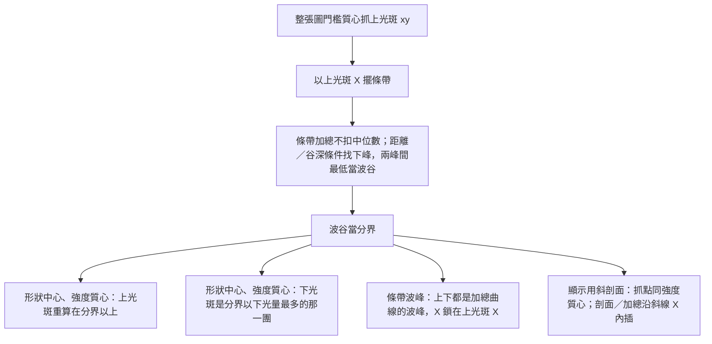

# 上下光斑演算法

對齊程式：`analysis/spots/`（四種抓法分檔）、`analysis/dual_spot.py`（對外 API）、`analysis/spot_window.py` 的條帶位置。

四種抓法的專章與自動更新說明見 **[spot_finding.md](spot_finding.md)**（由 `script/update_spot_finding_doc.py` 產生）。

HDR 主視窗中間是分析功能區，右側統一用分析畫布。計算完成後會自動帶入 × 255 之後的線性強度；按「分析」會再送一次並重抓。兩種 Mertens 的浮點結果已經 × 255；Debevec、Robertson 和單張會再 × 255。找點用這個尺度，不含 log。畫布左上角的 log、abs 與色條上下限／色彩三角只改顯示；找點不參與。高斯模糊也在畫布左上角，會進演算法輸入。條帶只調寬度，左右以上光斑的 X 為中心，不能手動移動。Y 固定為整張影像高度。下光斑不做圓形平均。

---

## 總流程

座標都是全影像像素，原點在左上，Y 向下。

---

## 1. 上光斑

1. 在**整張圖**的原始強度上找（不扣四邊背景；光斑不一定在中間，四邊不可靠）。
2. 門檻 = 使用者百分比 × 這張圖的最強訊號。預設 50%。
3. 留下不低於門檻、而且跟最強像素連在一起的那一塊。
4. 上光斑是這一塊的強度加權質心，得到 xy。
5. 再以上光斑 X 為中心擺條帶。不再用最亮點 X 當種子，也不再重擺條帶。

半透明白色遮罩是條帶內、波谷分界以上的門檻核心。

找到波谷之後會在條帶內再算一次，分界以下的列清掉，所以上光斑不會跨過波谷中心。選條帶波峰時，這次重算只更新白色遮罩；畫面上只顯示兩個加總波峰的 Y，X 固定在條帶中心（上光斑種子 X）。

---

## 2. 條帶與波谷

條帶寬度由使用者設定。左右位置以上光斑的 X 為中心，不能另調。貼到影像邊緣時會被裁切，這時中心會盡量靠近上光斑。Y 仍是整張高度。

條帶是這段寬度裡每一列沿 X 的加總，**不扣中位數**。从上光斑 Y 往下找局部波峰，條件是：

- **距離**：下峰至少在上光斑下方 N 像素。N 可在視窗「距離」調整，預設 50。
- **下峰比**：下峰條帶加總至少達到上峰加總的 M%。M 可在視窗「下峰比」調整，預設 10%；0% 表示不檢查。用來擋主峰後貼底的雜訊。
- **谷深**：兩峰之間的最低點低於該下峰的 65%（相對下峰有明顯降下再升起）。
- 通過條件的下峰裡取**最高**的那個，避免上峰旁邊的小凸起。

波谷 = 上光斑與這個下峰之間的**最低點**。選條帶波峰時，下光斑的 Y 就是這個下峰，上光斑的 Y 是波谷以上最高的加總波峰（沒有下光斑時也是整段條帶加總的最高峰）；兩邊的 X 都固定在條帶中心，距離用兩個 Y 的差。重抓後剖面十字會對到上光斑。

---

## 3. 下光斑

範圍從波谷中心的下一列，一直到條帶底部。

1. 在分界以下的範圍用原始強度（不扣邊緣中位數）。
2. 門檻 = **下門檻 %** × 這段範圍內最強訊號（與上門檻分開）；留下不低於門檻、且跟最亮點連通的那一塊。避免暗暈把質心往下拉。下光斑較暗時可把下門檻調低。
3. 中心有四種，在分析視窗的「演算法」選擇：

- 形狀中心：範圍內每個像素一樣重，落在光團的幾何中間。
- 強度質心：用範圍內的線性強度加權。
- 條帶波峰：不用這團像素。上光斑是波谷以上最高的加總波峰，下光斑是通過條件的那個波峰。結果只顯示兩個 Y；X 固定在條帶中心，距離為 |ΔY|。下門檻不套用。
- 顯示用斜剖面：抓點和強度質心相同；只改 Y 剖面／加總的顯示。剖面沿上下光斑虛線，每一列在中心 X 線性內插取值，顯示平面和熱圖同一套。加總依上下光斑的 \(\tan\) 框出斜向範圍（寬度沿用「寬」）；每一列沿 X 先線性內插再積分加總，不扣中位數。熱圖畫出斜向範圍。虛線穿過兩個光斑。

\[
x = \frac{\sum x_i I_i}{\sum I_i}, \quad
y = \frac{\sum y_i I_i}{\sum I_i}
\]

\(I_i\) 是範圍內的線性強度。亮的像素權重高，所以強度質心會比形狀中心更靠近上面較亮的一側。這兩種都不是抓強度最大的那一個像素。條帶波峰的兩個 Y 都在條帶加總曲線上。

下光斑必須在波谷下方，且與上光斑的 Y 距離大於「距離」設定，否則視為沒找到。

色條下方是黑色、中間是藍、青、綠、黃、紅，上方是白色。分析畫面下方有這七個色塊三角的位置，0 在下方，1 在上方，只改顏色分佈。送進分析時會帶入融合區目前的三角位置和色階上下限。

滑鼠移到左側條帶曲線上時，數值窗固定在該剖面圖的右上角，標出該點的 Y 像素和畫面上的加總值。字太寬時整框留在畫面裡。熱圖和條帶的游標讀數都在畫布左下方，白底單列，版型和 HDR 測試視窗相同。

---

## 參數

| 參數 | 作用 |
| --- | --- |
| 寬 | 條帶寬度。直條帶時左右以上光斑 X 為中心；顯示用斜剖面的 Y 加總時是斜向範圍寬度 |
| 距離 | 上光斑到下峰的最小像素距離，預設 50。用來擋上峰旁邊的小凸起 |
| 下峰比 | 下峰加總相對上峰加總的最低比例，預設 10%。0% 不檢查。太矮的下峰視為沒找到 |
| Y 剖面 / Y 加總 | 顯示用斜剖面專用。剖面沿虛線每一列在中心 X 線性內插；加總是斜向範圍每一列沿 X 線性內插後加總 |
| 上門檻 % | 上光斑留下不低於峰值這個比例的核心；也用來擺條帶 |
| 下門檻 % | 波谷以下下光斑 blob 相對該區峰值的比例；形狀中心／強度質心／顯示用斜剖面用。條帶波峰時停用 |
| 演算法 | 形狀中心、強度質心、條帶波峰或顯示用斜剖面 |
| Y 剖面 / Y 加總 | 畫布左上角。左側是 Y 曲線，下方是 X 剖面。點熱圖可改十字。一般模式：剖面是十字那一欄，加總是粉紅 ROI／條帶範圍內每一列沿 X 加總；顯示用斜剖面時改為斜線剖面／斜向加總 |
| log / abs | 畫布左上角。只改顯示；找點不參與 |
| 高斯模糊 | 畫布左上角。進演算法輸入與浮點結果 |
| 色條上下限／三角 | 畫布上，融合與分析共用。只改熱圖色階與顏色分佈 |

---

## 兩個中心的差別

形狀中心和強度質心時，上光斑是強度加權質心，權重是門檻核心裡的線性強度。選條帶波峰時，這個質心只用來擺條帶；畫面上的上光斑改成波谷以上最高的加總波峰。

下光斑可以選。形狀中心落在光團中間。強度質心用同一團的線性亮度當權重，會偏向上面較亮的一側。條帶波峰只報兩個加總峰的 Y（X 固定條帶中心）。顯示用斜剖面的光斑位置和強度質心相同，只改剖面／加總顯示。Y 剖面沿虛線每一列在中心 X 線性內插；Y 加總是斜向範圍每一列沿 X 線性內插後加總。虛線穿過兩個光斑。預設是形狀中心。

兩個中心都找到時，結果卡顯示上／下光斑座標、本筆距離，以及距離表有效筆數的平均與標準差。距離格式是 `px / μm`（`μm = px × 3.45`）；少一個光斑時距離是 `—`。標準差用樣本標準差，只有一筆時為 0。結果下方的距離表每一筆一列，欄位是筆數、px 和 μm，內容置中。點一列會切到那一張。改條帶寬度、上下門檻或演算法後，表格會依同一套抓法重算。

HDR 測試視窗勾選批次融合後，分析區會出現主資料夾名稱與筆數。0 是第一張，和主資料夾筆數相同。張數較少的曝光在後面幾筆會固定用該曝光最後一張。切換筆數時，條帶寬度、上下門檻和下光斑演算法留在目前的設定，再對這一張重抓。

結果下方的「匯出」先選一個父資料夾，再於其中**新建以目前點位命名的子資料夾**（例如 `X0_Y90.85`），CSV、參數 JSON 和熱圖都寫進該子資料夾，檔名帶同一個時間戳。熱圖是套上目前色階和色條顏色的影像，不含色條，也不含 ROI 範圍。只有一張時檔名是 `heatmap_時間戳.png`；批次時每一筆一張，檔名是 `heatmap_時間戳_筆數.png`。`params_時間戳.json` 記錄條帶寬度、上下門檻、演算法、log、abs、色階和七個色條三角的位置。

- `spots_時間戳.csv`：一筆影像一列。欄位是 `frame`、`file`、`strip_width`、`min_peak_distance`、`threshold_percent`、`lower_threshold_percent`、`center_mode`、`upper_x`、`upper_y`、`lower_x`、`lower_y`、`distance_px`、`distance_um`。`frame` 是筆數，0 是第一張。少一個光斑時，該光斑和距離留空。
- `strip_sum_raw_時間戳.csv`：條帶加總（找波谷用的原始加總）。第一行是標題，第一欄 `y_px`，後面每一筆影像往右一欄。
- `strip_sum_時間戳.csv`：畫面上的條帶曲線。有勾 abs 或 log 時跟左側曲線一樣。欄位排法和上一份相同。

只有一張影像時，加總檔的曲線欄名是 `strip_sum_raw` 和 `strip_sum`。有批次資料時，欄名是筆數 `0`、`1`、…，每一筆都用目前的條帶寬度、上下門檻和演算法重抓。匯出按鈕下方有進度條，先顯示正在匯出的筆數，再顯示熱圖進度。寫完會跳出完成視窗。

---

## 修改紀錄

| 日期 | 修改 |
| --- | --- |
| 2026-10-27 | 下光斑改為波谷以下相對峰值門檻核心（沿用上光斑門檻％），不再用 >0 整團連通。 |
| 2026-10-27 | 下光斑也不再扣左右邊緣中位數，直接在原始強度上找連通區。 |
| 2026-10-27 | 線性內差的 Y 加總也不再扣中位數。 |
| 2026-10-27 | 條帶加總改為不扣中位數；波谷改為合格下峰與上峰之間的最低點。距離可調，預設 50。 |
| 2026-10-27 | 上光斑改為不扣四邊背景，直接在原始強度上門檻質心。 |
| 2026-10-27 | 改成先在整張圖抓上光斑 xy，再擺條帶；拿掉以上光斑 X 重擺條帶的迴圈。 |
| 2026-10-27 | 線性內差的 Y 剖面改成沿虛線每一列在中心 X 線性內插，不再只取上光斑那一列。 |
| 2026-10-27 | 線性內差的 Y 加總改成每一列沿 X 線性內插後再加總；拿掉兩光斑 Y 之間的直線蓋值。 |
| 2026-10-27 | 線性內差可切 Y 剖面／Y 加總。加總依上下光斑 tan 框斜向範圍。 |
| 2026-10-26 | 線性內差的熱圖虛線改成穿過上光斑和下光斑。 |
| 2026-10-26 | 線性內差的 Y 軸改成和熱圖游標同一列的顯示強度，不再把谷底內差抬高。 |
| 2026-10-27 | 整頁排版：兩側欄同寬、參數收進卡片、畫布工具列分兩排。 |
| 2026-10-27 | 結果區改成對齊卡：上／下光斑、距離、平均、標準差。 |
| 2026-10-27 | 結果區加上距離 average／std（有效筆數；std 為樣本標準差）。 |
| 2026-10-27 | 波谷谷深門檻改回 65%。 |
| 2026-10-27 | 下峰加「下峰比」可調（預設 10%），矮於上峰比例的凸起不當下光斑。 |
| 2026-10-28 | 分析匯出改為在選定父資料夾下新建「點位」子資料夾，再寫入 CSV／JSON／熱圖。 |
| 2026-10-28 | 波谷深度改相對上峰判斷（不再相對下峰）；下峰允許平頂，找不到局部峰時用「最深谷後最高點」備援。不做平滑。 |
| 2026-10-28 | 新增測試演算法「斜向迭代」：直條帶強度質心後，沿連線斜條帶重抓。 |
| 2026-10-28 | 上門檻／下門檻拆開；下光斑 blob 用下門檻。線性內差改名顯示用斜剖面。 |
| 2026-10-27 | 條帶波峰改為只顯示兩個 Y；X 固定條帶中心，距離用 |ΔY|。 |
| 2026-10-27 | 條帶波峰的 X 改為峰列最亮點；重抓後剖面十字對到上光斑。 |
| 2026-10-27 | 條帶波峰：即使沒有下光斑，上光斑 Y 也改抓條帶加總最高峰，不再留在質心。 |
| 2026-10-27 | 高斯模糊移到畫布左上角；輸入框滾輪不改數值。 |
| 2026-10-27 | Y 加總改為粉紅 ROI／條帶範圍加總，不再整列全寬。 |
| 2026-10-27 | 拿掉畫布顯示平滑；高斯模糊只留在融合功能區。 |
| 2026-10-27 | 分析畫布加上 X／Y 剖面；Y 可切剖面或加總。 |
| 2026-10-27 | 統一分析畫布；log／abs／平滑與色條留在畫布。 |
| 2026-10-27 | 分析顯示控制移到中欄；拿掉分析的平滑與 color scale。 |
| 2026-10-27 | 分析併入 HDR 主視窗中欄；畫布可切融合／分析畫面。 |
| 2026-10-22 | 分析視窗的條帶數值窗固定在剖面圖右上角。 |
| 2026-10-22 | 距離表拿掉檔名欄，只留筆數、px 和 μm。 |
| 2026-10-22 | 距離清單改成表格。檔名欄可單獨用滾輪左右移動。 |
| 2026-10-22 | 分析視窗左側列出每一筆距離。匯出時顯示進度條。 |
| 2026-10-22 | 分析視窗可調色條三角，並沿用融合視窗目前的位置和色階。匯出加上參數 JSON 和熱圖。 |
| 2026-10-22 | 分析匯出分成光斑、未扣中位數加總、已扣中位數加總三個 CSV。 |
| 2026-10-22 | 批次融合的結果可在分析視窗逐筆查看，抓法沿用目前設定。 |
| 2026-10-22 | 分析 CSV 的光斑座標和距離只寫第一筆。 |
| 2026-10-22 | 條帶波峰的上下光斑都改抓加總波峰。匯出多一欄未扣中位數的條帶加總。 |
| 2026-10-21 | 條帶波峰的 X 改成跟上光斑相同。 |
| 2026-10-21 | 下光斑新增條帶波峰。Y 是條帶加總的波峰，X 是該列的強度質心。 |
| 2026-10-21 | 分析視窗可匯出一個 CSV，含條帶加總、上光斑、下光斑和距離。 |
| 2026-10-21 | 分析視窗的數值改為 × 255 之後的 8-bit 尺度。Mertens 已乘過；Debevec、Robertson 和單張再 × 255。 |
| 2026-10-21 | 分析視窗拿掉平滑窗。下光斑和左側預覽都不做圓形平均。 |
| 2026-10-21 | 下光斑不再做圓形平均。平滑窗先留在畫面上，不參與找點。 |
| 2026-10-21 | 分析視窗和找點複製到 `HDR/analysis`。顯示輔助在 `analysis/display.py`，不再讀 `FourStepAdj`。 |
| 2026-10-15 | 畫布左下方的游標讀數高度固定為兩列。 |
| 2026-10-15 | 游標讀數改到畫布左下方。滑鼠在熱圖上會顯示該點像素和畫面上的強度。 |
| 2026-10-15 | 畫布 Gaussian blur 可分別調水平核寬、垂直核寬和 sigma。預設 3、3、0.8。左側平滑窗仍是圓形平均。 |
| 2026-10-15 | 畫布平滑從 n×n 平均改成 Gaussian blur。n 仍是核寬，預設 3。左側平滑窗仍是圓形平均。 |
| 2026-10-15 | 勾選 log 時，color scale 輸入框改成 log10，取消勾選再換成 10 的次方。熱圖仍用線性門檻再取 log。找點不套。 |
| 2026-10-14 | color scale 的下限或上限留空代表不採用。熱圖和圓形平均預覽只套有填的那一側。找點仍不套。 |
| 2026-10-14 | 熱圖和圓形平均預覽改成先平滑，再套 color scale，最後才 log。找點和條帶圖不套這個平滑。 |
| 2026-10-14 | 平滑改到 color scale 之後。熱圖和圓形平均預覽先套門檻，再做 n×n。找點和條帶圖不套這個平滑。 |
| 2026-10-14 | abs 右邊加上平滑。勾選後熱圖和圓形平均預覽做 n×n 平均，預設 n 為 3。找點和條帶圖不套這個平滑。 |
| 2026-10-14 | 同時勾選 abs 和 color scale 時，熱圖和平滑圖先取絕對值再套門檻。找點仍用原本的線性強度。 |
| 2026-10-14 | 畫布在 log 和 color scale 中間加上 abs。勾選後熱圖、平滑圖和條帶圖改顯示絕對值。找點仍用原本的線性強度。 |
| 2026-10-14 | 滑鼠移到條帶曲線上，會顯示該點的 Y 像素和畫面上的加總值。 |
| 2026-10-14 | 畫布 log 旁邊加上 color scale。只改熱圖和平滑圖，找點仍用沒裁過的線性強度。 |
| 2026-10-13 | 條帶只留寬度。左右以上光斑 X 為中心，不能手動調位置。 |
| 2026-10-12 | 定下目前找點流程：上光斑是最強像素的門檻質心，波谷中心分開上下光斑，下光斑可選形狀中心或強度質心。平滑預覽是整張影像的圓形平均。 |
