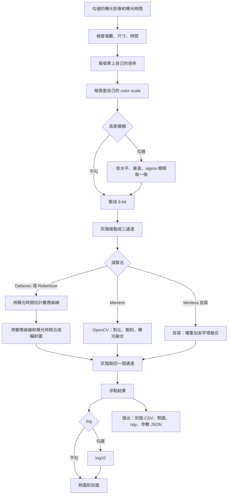

# HDR 演算法流程

對齊程式：`hdr_algorithms.py` 的 `run_hdr`、`to_uint8`；`mertens_local.py`；`hdr_test.py` 的 `preprocess_exposure`、`display_log10`（2026-10-21）

這份只記按「計算」之後的順序。視窗操作和每個參數的作用見 `hdr.md`。

---

## 總流程

倍率、各張的 color scale 和高斯模糊在演算法之前，會寫進浮點結果。按「匯出」一次寫出 `profiles_時間戳.csv`、`heatmap_時間戳.png`、`hdr_時間戳.npy`、`params_時間戳.json`。剖面的六條曲線在同一個 CSV，第一行是標題，曲線往右各成一欄。寫完會跳出完成視窗。熱圖含 log 時的畫面，不含色條和十字。Debevec、Robertson 和單張的 npy 是浮點結果再乘目前滿量（預設 4095）。兩種 Mertens 的浮點結果已經乘 255，npy 不再乘滿量。分析視窗用 × 255 之後的數值：Mertens 直接送入，Debevec、Robertson 和單張再 × 255，不含 log。分析視窗的「匯出」寫三個 CSV、參數 JSON 和熱圖。熱圖不含色條和 ROI。按「分析」時帶入融合視窗目前的色條三角和色階。游標讀的是這個浮點結果；熱圖、色條、X 剖面、Y 剖面和 Y 累加在有勾 log 時讀 log 後的預覽。

---

## 1. 計算前檢查

只用有勾選的列。沒有勾選就停止。只勾一張時，做完輸入前處理就當浮點結果顯示，不跑 HDR。兩張以上才進演算法：每張的高、寬、通道數必須相同；每張曝光時間都要是大於 0 的有限數字，單位是 us，接著乘 `1e-6` 變成秒。Debevec 和 Robertson 還要求這些時間不能全部相同。Mertens 不使用曝光時間，時間相同也可以算。

勾選「批次融合」時，同一組參數依主資料夾的排序，從第 0 筆做到張數最多的那個曝光。張數較少的曝光固定重用最後一張。每一筆都是倍率、color scale、高斯模糊，再進演算法。進度條顯示目前筆數。主視窗中間的分析區可改筆數，抓法沿用分析區的條帶寬度、上下門檻和下光斑演算法。

---

## 1b. 輸入前處理

每一張勾選的曝光先做這三步，再壓成 8-bit：

1. **倍率**：該列的數字，預設 1。像素先乘上它。
2. **color scale**：該列自己的下限和上限。小於等於下限改成 0，大於等於上限改成上限。留空的那一側不採用。
3. **高斯模糊**（可勾選，每一張共用）：水平、垂直核寬和共用的 sigma。核寬是 1 的方向不模糊。

這三步會進演算法輸入和浮點結果；匯出 npy 再乘滿量。

---

## 2. 壓成 8-bit

OpenCV 這三個方法吃 8-bit 影像。

- 檔案本身是 8-bit：數值原樣送進去。
- 其他型別：`四捨五入(像素 / 滿量 × 255)`，再裁到 0–255。各張共用同一個滿量。預設滿量 4095。

灰階在這一步之後會複製成三個相同通道。OpenCV 算出來若是三通道，灰階再只留第一個通道。響應曲線也只留第一個通道。

---

## 3. 用曝光時間估計響應曲線

Debevec 和 Robertson 都先估計相機響應，再合成輻射圖。響應曲線是「場景亮度乘上曝光時間」和「拍到的像素值」的對應。曝光時間是已知的，用來把同一點在不同照片裡的像素值排到同一條曲線上。

同一個點的真實亮度 E 不變。曝光 j 的時間是 Δtⱼ 時，進到感光元件的量是 E × Δtⱼ，相機再把它變成像素值 Z：

Z = f(E × Δtⱼ)

f 就是相機響應。估計時解的是它的反函數：由像素值回到 E × Δt。取對數後變成

g(Z) = ln E + ln Δt

g 是整台相機共用的一條曲線，ln E 每個像素不同，ln Δt 由曝光時間直接算出。時間拉長，同一點的 Z 會變亮，但該點的 ln E 必須維持同一個數，曲線就靠這個限制被算出來。

程式把 us 乘上 10⁻⁶ 變成秒後送進 OpenCV。各張時間的比例才有用。曲線橫軸是 8-bit 像素值 0–255。合成輻射圖的做法見下一節。

Mertens 不估計這條曲線，也不使用曝光時間。

---

## 4. 用響應曲線和曝光時間合成輻射圖

合成是把上一節的式子倒過來。每個像素先用響應曲線和該張的曝光時間還原成亮度 E，再把各張可靠的估計合成同一個 E。

由 g(Z) = ln E + ln Δt 可得

E = exp(g(Z) − ln Δt) = exp(g(Z)) / Δt

同一點在每一張照片都會得到一個 E。像素太暗或太亮時，曲線兩端不可靠，所以中間調的權重高、接近 0 和 255 的權重低。最後的輻射是這些 E 的加權平均。

Debevec 的曲線 g 是對數形式，`MergeDebevec` 直接用上面的式子。Robertson 疊代時把曲線和亮度一起更新，`MergeRobertson` 同樣是曲線還原後再除以曝光時間，再依像素可靠程度加權。兩種方法都使用同一組曝光時間：估計曲線時用過，合成輻射圖時再用來除掉曝光的影響。

得到的 float32 輻射圖就是這次的浮點結果。Mertens 沒有響應曲線，不做這一步。

---

## 5. Debevec

1. 用樣本數、lambda、隨機抽樣建立 `CalibrateDebevec`。
2. 把 8-bit 影像和曝光秒數送進去，得到響應曲線。橫軸是像素值 0–255，每一通道一條。
3. 用 `MergeDebevec` 把同一組影像、秒數和這條曲線合成一張 float32 輻射圖。

輻射圖就是這次的浮點結果。左下方畫這條響應曲線。

---

## 6. Robertson

1. 用疊代次數和收斂門檻建立 `CalibrateRobertson`。
2. 把 8-bit 影像和曝光秒數送進去。響應和輻射會互相更新，變化小於收斂門檻，或達到疊代次數，就停止。
3. 用 `MergeRobertson` 把同一組影像、秒數和得到的響應曲線合成一張 float32 輻射圖。

輻射圖就是這次的浮點結果。有曲線時，左下方一樣畫響應曲線。

---

## 7. Mertens

1. 用對比、飽和、曝光三個權重建立 `MergeMertens`。
2. 只把 8-bit 影像送進去，不送曝光時間，也不估計響應曲線。
3. 每個像素依這三個權重，從各張曝光裡挑出要留下的成分，合成一張 float32 融合圖。
4. 小於 0 的像素改成 0，再乘 255。大於 255 的值保留。匯出 npy 不再乘滿量。

融合圖就是這次的浮點結果。左下方不畫曲線。

---

## 7b. Mertens 自寫

1. 在 `mertens_local.py` 把影像壓成 8-bit，灰階保持單通道。
2. 依對比、飽和、曝光和可調的 sigma 算權重，再正規化。
3. 用拉普拉斯金字塔融合，得到 float32 融合圖。小於 0 的像素改成 0，再乘 255。大於 255 的值保留。匯出 npy 不再乘滿量。

步驟和公式見 `mertens_local.md`。左下方不畫曲線。

---

## 8. 畫面

沒有色調映射。熱圖、色條和兩張剖面直接用浮點結果。彩色結果在這三個地方再用三個通道的平均。

勾 log 時，熱圖和剖面改畫浮點結果的 `log10`。峰值大於 1.5 時用下限 1，否則用很小的下限。Mertens 已乘 255，會用下限 1。游標仍顯示 log 前的浮點結果；彩色時三個通道都列出來。

---

## 9. 畫面上的十字

計算完成、影像尺寸改變，或十字超出影像時，十字放到畫面最亮的像素，熱圖和剖面的範圍回到整張圖。同一張圖只切換 log 時，十字留在原像素，熱圖的縮放也留著，強度軸改畫新的曲線。

點熱圖會把十字移到該像素，X 剖面改成該列。畫布左上角可點 Y 剖面或 Y 累加，一次只會選一個。Y 剖面曲線區的寬度和 X 剖面曲線區的高度相同。切換時外框大小不變，像素軸留在原本的範圍，強度軸改配到新的曲線。剖面是該行；累加是計算範圍 ROI 內每一列沿 X 加總。分析畫布的 Y 加總是粉紅條帶 ROI。有勾 log 時，累加先加總線性值再取 log10。滑鼠移到 X 剖面或左側曲線上時，數值窗放在該剖面圖的右上角；字太寬時整框留在畫面裡。點強度軸兩端只改顯示範圍，不重算演算法。畫布右上角的色條下限和上限，以及右下方兩區的色條三角位置，都只改色條顯示。輸入框按 Ctrl+Z 會回到上一個確定的數值。

---

## 修改紀錄

| 日期 | 修改 |
| --- | --- |
| 2026-10-27 | 四種抓法拆 `analysis/spots/`；`spot_finding.md` 腳本自動更新；UI 排版微調。 |
| 2026-10-27 | 曝光表只列已匯入時間；自動偵測任意 Nus。 |
| 2026-10-27 | 可載入父資料夾，子資料夾當點位（名稱排序）；切換點位重選範圍、保留參數；批次只跑目前點位。舊「載入主資料夾」保留。 |
| 2026-10-27 | 分析併入主視窗三欄：融合｜分析｜畫布。 |
| 2026-10-27 | 批次與載入：曝光張數不同時重用較短曝光最後一張；批次筆數跟最長曝光。 |
| 2026-10-26 | 主資料夾依檔名讀取曝光時間。載入後框選可拖移的 512×512 計算範圍，批次融合沿用；清空後要重框。 |
| 2026-10-22 | 距離表的筆數、px、μm 改為置中。 |
| 2026-10-22 | 距離表拿掉檔名欄，只留筆數、px 和 μm。 |
| 2026-10-22 | 距離清單改成表格。檔名欄可單獨用滾輪左右移動。 |
| 2026-10-22 | 分析視窗左側列出每一筆距離。匯出時顯示進度條。 |
| 2026-10-22 | 分析視窗可調色條三角，並沿用融合視窗目前的位置和色階。匯出加上參數 JSON 和熱圖。 |
| 2026-10-22 | 分析匯出分成光斑、未扣中位數加總、已扣中位數加總三個 CSV。 |
| 2026-10-22 | 可勾選批次融合。同一組參數套到主資料夾每一筆，分析視窗可逐筆查看。 |
| 2026-10-22 | 分析 CSV 的光斑座標和距離只寫第一筆。 |
| 2026-10-22 | 分析 CSV 多一欄未扣中位數的條帶加總。條帶波峰的上下光斑都改抓加總波峰。 |
| 2026-10-21 | 每一列曝光可設倍率和自己的 color scale。融合前順序改成倍率、color scale、高斯模糊。 |
| 2026-10-21 | 分析視窗可匯出一個 CSV，含條帶加總、上光斑、下光斑和距離。 |
| 2026-10-21 | 剖面數值窗改放在畫面裡，不再被剖面邊界裁掉。 |
| 2026-10-21 | Y 剖面曲線區寬度改成和 X 剖面曲線區高度相同。 |
| 2026-10-21 | 剖面 CSV 改成第一行標題，六條曲線往右各成一欄。 |
| 2026-10-21 | 切換 Y 剖面和 Y 累加時，剖面外框大小固定。強度軸改配到新曲線，像素軸不重設。 |
| 2026-10-21 | 剖面改成一個英文檔名的 CSV。匯出檔名改為英文，完成後跳出視窗。 |
| 2026-10-22 | 畫布左上角的 Y 剖面／Y 累加方框固定成較長文字的寬度，切換時不跳動。 |
| 2026-10-21 | 輸入框可用 Ctrl+Z 回到上一個確定的數值。 |
| 2026-10-21 | 分析視窗用 × 255 之後的數值。Mertens 直接送入；Debevec、Robertson 和單張再 × 255。 |
| 2026-10-21 | 滑鼠移到 X 剖面或左側曲線上時，顯示該點的像素和強度。 |
| 2026-10-21 | 程式和說明移到 `beamAnalysis/HDR`。 |
| 2026-10-21 | 兩種 Mertens 融合圖再 × 255。這兩種的 npy 不再乘滿量。 |
| 2026-10-21 | 兩種 Mertens 融合後把小於 0 的像素改成 0。 |
| 2026-10-21 | 拿掉色調映射。熱圖和剖面直接用浮點結果，log 仍只改預覽。 |
| 2026-10-20 | 匯出 npy 改為浮點結果 × 滿量。 |
| 2026-10-20 | 左側可切 Y 剖面／Y 累加。 |
| 2026-10-20 | log 改為作用在浮點結果；0–1 資料不再被壓成全 0。 |
| 2026-10-20 | 只勾一張時可直接顯示，不跑 HDR。 |
| 2026-10-20 | 輸入改為先模糊再 color scale 後才算；預覽可勾 log。高斯模糊不再放在演算法之後。 |
| 2026-10-20 | 總流程加上 Mertens 自寫；細節見 `mertens_local.md`。 |
| 2026-10-20 | Debevec、Robertson、Mertens 改由 `hdr_algorithms.py` 計算；視窗仍負責模糊和色調映射。 |
| 2026-10-19 | 浮點結果和色調映射之間可勾選高斯模糊。預覽和剖面用模糊後的圖，npy 與游標不用。 |
| 2026-10-16 | 補上 Gamma、Drago、Reinhard、Mantiuk 四種色調映射的用途。 |
| 2026-10-16 | 補上用響應曲線和曝光時間合成輻射圖：E = exp(g(Z)) / Δt，再對各張加權平均。 |
| 2026-10-16 | 補上曝光時間如何用來估計響應曲線：g(Z) = ln E + ln Δt。 |
| 2026-10-16 | 整理 Debevec、Robertson、Mertens 從檢查、8-bit、合成到色調映射的計算順序。 |
