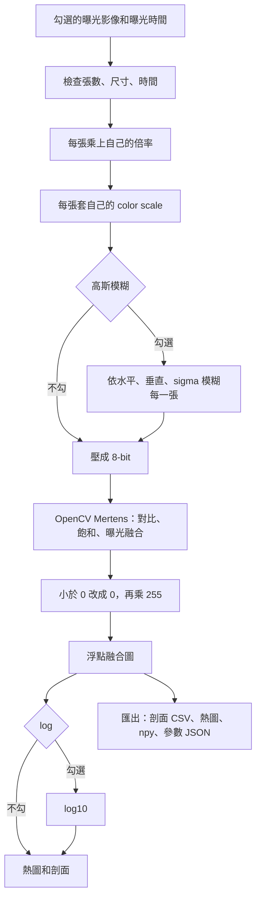

# HDR 演算法流程（Mertens）

對齊程式：`hdr_algorithms.py` 的 `merge_mertens`、`to_uint8`；`hdr_test.py` 的 `preprocess_exposure`、`display_log10`（2026-10-22）

這份的前面和 `hdr_flow.md` 相同，記按「計算」之後、進演算法之前的順序。演算法只寫 OpenCV Mertens。視窗操作和每個參數的作用見 `hdr.md`。

---

## 總流程

倍率、各張的 color scale 和高斯模糊在演算法之前，會寫進浮點結果。按「匯出」一次寫出 `profiles_時間戳.csv`、`heatmap_時間戳.png`、`hdr_時間戳.npy`、`params_時間戳.json`。剖面的六條曲線在同一個 CSV，第一行是標題，曲線往右各成一欄。寫完會跳出完成視窗。熱圖含 log 時的畫面，不含色條和十字。Mertens 的浮點結果已經乘 255，npy 不再乘滿量。分析視窗直接用這個結果，不含 log。分析視窗的「匯出」寫三個 CSV、參數 JSON 和熱圖。熱圖不含色條和 ROI。按「分析」時帶入融合視窗目前的色條三角和色階。游標讀的是這個浮點結果；熱圖、色條、X 剖面、Y 剖面和 Y 累加在有勾 log 時讀 log 後的預覽。

---

## 1. 計算前檢查

只用有勾選的列。沒有勾選就停止。只勾一張時，做完輸入前處理就當浮點結果顯示，不跑 HDR。兩張以上才進演算法：每張的高、寬、通道數必須相同；每張曝光時間都要是大於 0 的有限數字，單位是 us。Mertens 不使用曝光時間，時間相同也可以算。勾選批次融合時，同一組參數會套到主資料夾每一筆，分析視窗再逐筆用同一套抓法。

---

## 1b. 輸入前處理

每一張勾選的曝光先做這三步，再壓成 8-bit：

1. **倍率**：該列的數字，預設 1。像素先乘上它。
2. **color scale**：該列自己的下限和上限。小於等於下限改成 0，大於等於上限改成上限。留空的那一側不採用。
3. **高斯模糊**（可勾選，每一張共用）：水平、垂直核寬和共用的 sigma。核寬是 1 的方向不模糊。

這三步會進演算法輸入和浮點結果。

---

## 2. 壓成 8-bit

OpenCV Mertens 吃 8-bit 影像。

- 檔案本身是 8-bit：數值原樣送進去。
- 其他型別：`四捨五入(像素 / 滿量 × 255)`，再裁到 0–255。各張共用同一個滿量。預設滿量 4095。

灰階在這一步之後會複製成三個相同通道。融合完的灰階只留第一個通道。

---

## 3. Mertens

Mertens 不估計響應曲線，也不把像素還原成輻射。每張 8-bit 影像先除以 255，變成 0 到 1。每個像素再依畫質決定要留下哪一張的成分，合成一張融合圖。

1. 用對比、飽和、曝光三個權重建立 `MergeMertens`。預設分別是 1、1、0。
2. 只把 8-bit 影像送進去，不送曝光時間。
3. OpenCV 依下面的權重，用拉普拉斯金字塔合成一張 float32 融合圖。
4. 小於 0 的像素改成 0，再乘 255。大於 255 的值保留。

三個指標：

$$
C = \left|\nabla^{2} v_{\mathrm{gray}}\right|
$$

$C$ 是灰階的拉普拉斯絕對值。平坦的地方接近 0，邊緣比較大。

$$
S = \sqrt{\sum_{c=1}^{3}(v_c - \bar v)^{2}}
$$

$S$ 是三個通道偏離平均值的大小。灰階三個通道相同，$S$ 接近 0，飽和這個權重幾乎不作用。

$$
B = \prod_{c=1}^{3} \exp\!\left(-\frac{(v_c - 0.5)^{2}}{0.08}\right)
$$

$B$ 在像素值 0.5（8-bit 的 128）最高，靠近 0 或 1 就變小。分母 0.08 是 OpenCV 寫死的，不能調。

權重是三者的次方相乘：

$$
w = C^{\alpha} \times S^{\beta} \times B^{\gamma}
$$

$\alpha$、$\beta$、$\gamma$ 就是畫面上的對比、飽和、曝光，預設是 1、1、0。$\gamma = 0$ 時，正數的 0 次方是 1，所以預設不看 $B$。把曝光調成 1 才會偏好中灰。

各張權重再正規化，使同一像素的權重和為 1。融合用拉普拉斯金字塔：影像拆成各尺度的細節，權重做成高斯金字塔，每一層依權重加總，再由粗到細組回來。這樣交界不會出現一條硬切的黑邊。

得到的融合圖就是浮點結果。匯出 npy 不再乘滿量。左下方不畫曲線。

把曝光次方設為 1 時，一個灰階像素的 $B$ 大約是：

- $Z = 40$，$v = 0.157$，$B = 0.012$
- $Z = 128$，$v = 0.502$，$B = 1.000$
- $Z = 200$，$v = 0.784$，$B = 0.048$

$Z = 128$ 最接近中灰，$B$ 最高。

---

## 4. 畫面

沒有色調映射。熱圖、色條和兩張剖面直接用浮點結果。彩色結果在這三個地方再用三個通道的平均。

勾 log 時，熱圖和剖面改畫浮點結果的 `log10`。Mertens 已乘 255，峰值大於 1.5，log 用下限 1。游標仍顯示 log 前的浮點結果；彩色時三個通道都列出來。

---

## 5. 畫面上的十字

計算完成、影像尺寸改變，或十字超出影像時，十字放到畫面最亮的像素，熱圖和剖面的範圍回到整張圖。同一張圖只切換 log 時，十字留在原像素，熱圖的縮放也留著，強度軸改畫新的曲線。

點熱圖會把十字移到該像素，X 剖面改成該列。畫布左上角可點 Y 剖面或 Y 累加，一次只會選一個。Y 剖面曲線區的寬度和 X 剖面曲線區的高度相同。切換時外框大小不變，像素軸留在原本的範圍，強度軸改配到新的曲線。剖面是該行；累加是計算範圍 ROI 內每一列沿 X 加總。分析畫布的 Y 加總是粉紅條帶 ROI。有勾 log 時，累加先加總線性值再取 log10。滑鼠移到 X 剖面或左側曲線上時，數值窗放在該剖面圖的右上角；字太寬時整框留在畫面裡。點強度軸兩端只改顯示範圍，不重算演算法。畫布右上角的色條下限和上限，以及右下方兩區的色條三角位置，都只改色條顯示。輸入框按 Ctrl+Z 會回到上一個確定的數值。

---

## 修改紀錄

| 日期 | 修改 |
| --- | --- |
| 2026-10-26 | 主資料夾依檔名讀取曝光時間。載入後框選可拖移的 512×512 計算範圍，批次融合沿用；清空後要重框。 |
| 2026-10-22 | 距離表的筆數、px、μm 改為置中。 |
| 2026-10-22 | 距離表拿掉檔名欄，只留筆數、px 和 μm。 |
| 2026-10-22 | 距離清單改成表格。檔名欄可單獨用滾輪左右移動。 |
| 2026-10-22 | 分析視窗左側列出每一筆距離。匯出時顯示進度條。 |
| 2026-10-22 | 分析視窗可調色條三角，並沿用融合視窗目前的位置和色階。匯出加上參數 JSON 和熱圖。 |
| 2026-10-22 | 分析匯出分成光斑、未扣中位數加總、已扣中位數加總三個 CSV。 |
| 2026-10-22 | 批次融合會把同一組 Mertens 參數套到主資料夾每一筆。 |
| 2026-10-22 | 拿掉 Mertens 自寫，這份只寫 OpenCV Mertens。 |
| 2026-10-22 | 由 `hdr_flow.md` 整理出 Mertens 的計算順序。 |
