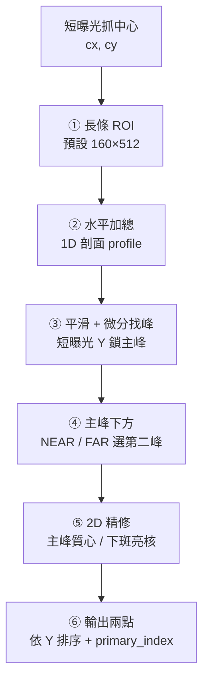
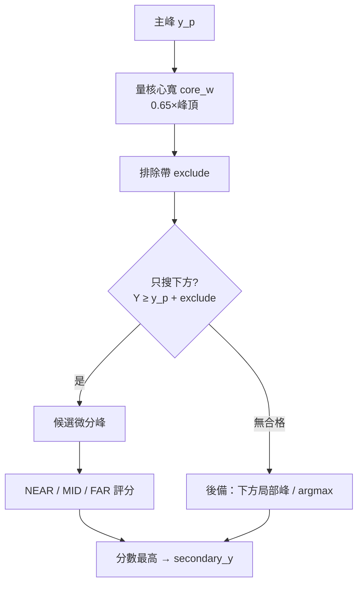
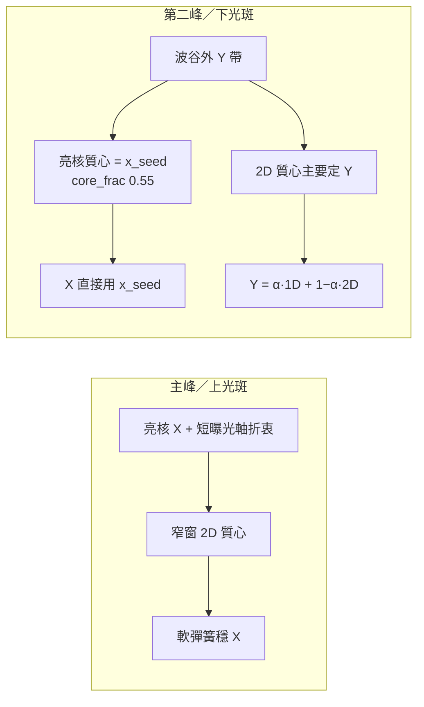

# 軸向一維投影＋微分法 — 作圖用摘要

對齊程式：`find_dual_spots_axial_1d_projection`（**2026-09-21**）  
完整公式／變更紀錄見：`axial_1d_projection_dual_spot.md`

本檔只保留**可直接畫圖**的流程、區塊與標註；細節參數以完整 md 為準。

---

## 圖 1｜總流程（建議主圖）



**簡標（投影片標題可用）：**

> 短曝光定位 → ROI → 水平加總 → 微分雙峰 → 精修輸出

---

## 圖 2｜資料流（短／長曝光分工）

```text
┌─────────────┐         ┌──────────────────────────────┐
│ 短曝光影像   │         │ 長曝光影像                    │
│ 抓 (cx, cy) │────────►│ 以 (cx,cy) 為心裁 ROI         │
└─────────────┘  軸心    │ 只在 ROI 內做 1D＋精修        │
                         └──────────────────────────────┘
```

| 角色 | 來源 | 用途 |
|------|------|------|
| 藍線／軸心 | 短曝光中心 | ROI 中心、主峰 hint、主峰 X 參考 |
| 紅／下斑 | 長曝光 ROI | 1D 第二峰 + 亮核精修 |

---

## 圖 3｜①～③ 剖面與主峰（左：影像｜右：1D）

```text
  長曝光 + ROI 框              profile(y)
  ┌──┬──────┬──┐              強度
  │  │ ████ │  │               ▲
  │  │ ████ │  │  水平加總      │    ★ 主峰 (hint≈短曝光 Y)
  │  │ ░░░░ │  │  ─────────►   │   /
  │  │ ▒▒▒▒ │  │               │  /
  │  │ ▒▒▒▒ │  │               │ ★ 第二峰候選…
  └──┴──────┴──┘               └────────► Y（向下）
```

**① ROI：** 以短曝光 `(cx,cy)` 為中心，寬×高條帶。  
**② 投影：** `profile(y) = max(列加總 − median, 0)`  
**③ 微分：** 平滑 → `dy` 正→負零交越 → 峰列表 → hint 鎖主峰 `y_p`

---

## 圖 4｜④ 第二峰怎麼選



| 模式 | 距離比 `sep/core_w` | 評分重點 |
|------|---------------------|----------|
| NEAR | ≤ 2.2 | 振幅 × contrast² |
| FAR | ≥ 3.8 | 振幅 × 振幅比 |
| MID | 中間 | 兩式取高 |

---

## 圖 5｜⑤ 2D 精修（現行）



| | 上光斑（主峰） | 下光斑（第二峰） |
|--|----------------|------------------|
| **X** | 亮核與短曝光軸折衷 → 窄窗質心 | **亮核質心**（不拉藍線） |
| **Y** | 2D 質心 | 1D 種子與 2D 混合 |
| **窗** | 主峰附近對稱 | 靠主峰側裁到波谷、外側加長 |

---

## 圖 6｜輸出對照（畫邊上註解用）

```text
全圖座標：
  spot_pri = (x0 + cx_pri, y0 + cy_pri)   ← 藍十字
  spot_sec = (x0 + cx_sec, y0 + cy_sec)   ← 紅十字

spots 依 Y 由小到大排序；
primary_index = 較接近短曝光中心者
```

---

## 一頁版文字稿（口條／註解）

1. **短曝光**先抓中心，當軸心。  
2. **長曝光**框長條 ROI，每列水平加總成 1D 剖面。  
3. **微分找峰**，用短曝光 Y 鎖定上光斑。  
4. **只往下**找第二峰，NEAR／FAR 打分選下光斑 Y。  
5. **精修**：上斑窄窗質心；下斑 X 跟亮核、Y 跟 1D／2D 混合。  
6. 輸出兩點十字。

---

## 畫圖建議色碼

| 元素 | 建議 |
|------|------|
| 短曝光／藍線／主峰 | 藍 |
| 下光斑／第二峰 | 紅／橙 |
| ROI 框 | 虛線橙 |
| 1D 剖面曲線 | 灰／白 |
| 排除帶／波谷 | 淺灰區帶 |

---

## 不畫進圖的（避免雜訊）

- 參數表、門檻微調數字（見完整 md）  
- 精修歷史版本／變更紀錄  
- UI 操作步驟  
